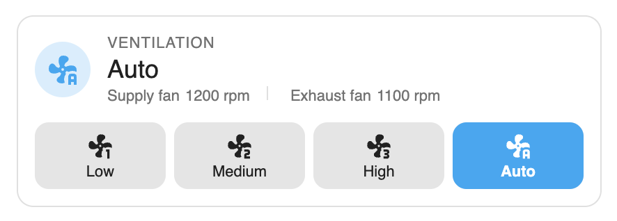

# Itho HRU Card

A Home Assistant Lovelace card for Itho Daalderop HRU ventilation units running the
[Itho WiFi add-on](https://github.com/arjenhiemstra/ithowifi). It shows the current operating mode
and fan speeds, and lets you switch between Low, Medium, High and Auto.



- The mode shown is always the one the unit reports, including changes made with the physical
  remote, automations or the add-on's web UI.
- A mode you request shows as "switching" until the unit confirms it. If it doesn't within the
  timeout, the card says "not confirmed" instead of guessing.
- Missing or unavailable entities are reported on the card instead of breaking it.
- Follows your theme, light or dark.

It only talks to Home Assistant entities and services. It does not use MQTT or the add-on's API
directly. Developed against an HRU ECO 350. Requires Home Assistant 2024.11 or newer.

## Installation

### HACS (custom repository)

1. In HACS, open the menu (⋮) and choose **Custom repositories**.
2. Add `https://github.com/David200337/itho-hru-card` with the type **Dashboard** (called
   **Lovelace** in older HACS versions).
3. Find **Itho HRU Card** in HACS and download it.
4. Reload the browser page. HACS registers the dashboard resource for you.

### Manual

1. Download `itho-hru-card.js` from the [latest release](https://github.com/David200337/itho-hru-card/releases/latest).
2. Copy it to `config/www/itho-hru-card.js` in your Home Assistant configuration folder.
3. Go to **Settings → Dashboards → ⋮ → Resources** (turn on Advanced mode in your user profile if
   you don't see it) and add `/local/itho-hru-card.js` as a **JavaScript module**.
4. Reload the browser page.

## Configuration

```yaml
type: custom:itho-hru-card
title: Ventilation
mode_entity: sensor.hru_350_actual_mode
control_entity: fan.attic_itho_daalderop_hru_eco_350_hru_co2_demand_fan
supply_fan_entity: sensor.hru_350_supply_fan_actual
exhaust_fan_entity: sensor.hru_350_exhaust_fan_actual
```

| Option               | Required | Default   | Description                                                                             |
| -------------------- | -------- | --------- | --------------------------------------------------------------------------------------- |
| `mode_entity`        | yes      |           | Sensor with the reported mode code (the add-on's "actual mode").                        |
| `control_entity`     | yes      |           | `fan.*` entity used to set the mode, via `fan.set_preset_mode`.                         |
| `title`              | no       |           | Caption above the mode. Shows "Current mode" when empty.                                |
| `supply_fan_entity`  | no       |           | Sensor with the supply fan speed. Hidden when not set.                                  |
| `exhaust_fan_entity` | no       |           | Sensor with the exhaust fan speed. Hidden when not set.                                 |
| `preset_modes`       | no       | see below | Maps each card mode (`low`, `medium`, `high`, `auto`) to a preset name.                 |
| `pending_timeout`    | no       | `60`      | Seconds to wait for the unit to report a requested mode before showing "not confirmed". |

Default presets, matching the add-on's names exactly (they are case-sensitive):

```yaml
preset_modes:
  low: Low
  medium: Medium
  high: High
  auto: Auto
```

### Finding your entity IDs

Entity IDs differ per installation, so use your own.

1. Go to **Settings → Devices & services → Entities** and search for your unit, for example `hru`
   or `itho`. All entities of the add-on belong to the same device.
2. `mode_entity`: the sensor named like **actual mode**. Its state is a number such as `24`.
3. `control_entity`: the `fan.*` entity of the unit. Its state is normally `unknown`, which is
   expected. Open it and check that the `preset_modes` attribute lists `Low`, `Medium`, `High` and
   `Auto`. If your names differ, set them in `preset_modes`.
4. `supply_fan_entity` and `exhaust_fan_entity`: the sensors named like **supply fan actual** and
   **exhaust fan actual**. The `sensor.*_supply_fan` and `_exhaust_fan` sensors created by the
   add-on's autodiscovery also work.

Entity details are also visible under **Developer tools → States**.

## Troubleshooting

- **The card shows a warning badge.** Open it to see which entity or preset is missing. Check the
  IDs and the `preset_modes` names.
- **The buttons are disabled.** The control entity is unavailable or not found. Check that the
  add-on is online.
- **"Not confirmed" after clicking a mode.** The command was sent, but the unit hasn't reported the
  new mode yet. The reported mode stays highlighted. Raise `pending_timeout` if your unit is slow
  to report.
- **A mode shows as "Mode 17".** The unit reports a code the card doesn't know. No button is
  highlighted.

## Development

See [docs/architecture.md](docs/architecture.md) and [docs/testing.md](docs/testing.md).

```sh
npm ci
npm run dev        # mock harness; the gallery shows every card state
npm test
npm run typecheck
npm run build      # dist/itho-hru-card.js
```

## Licence

[MIT](LICENSE)
